<a href="https://developwithsourav.github.io">
  <picture>
    <source media="(prefers-color-scheme: dark)" srcset="assets/header-dark.svg">
    <source media="(prefers-color-scheme: light)" srcset="assets/header-light.svg">
    
  </picture>
</a>

I'm a final-year Computer Science student at the University of Delhi, living in New Delhi. I build backend systems and data tools in Python, and I'm working towards AI engineering. I mostly use FastAPI and PostgreSQL, Flutter for mobile, and GitHub Actions or Azure DevOps to ship. I check the data before I trust a chart. My weather project is why: its first version plotted humidity and pressure that turned out to be random numbers.

Start with [Five Years of Indian Weather](https://github.com/developwithsourav/Weather-Data-Visualization) and its [report](https://developwithsourav.github.io/Weather-Data-Visualization/), or [ReproBot](https://github.com/developwithsourav/reprobot), which turns a GitHub issue into a script that reproduces the bug.

## What I work with

<picture>
  <source media="(prefers-color-scheme: dark)" srcset="https://skillicons.dev/icons?i=python%2Cfastapi%2Cpostgres%2Cflutter%2Cdart%2Ccpp%2Cjs%2Creact%2Cnextjs%2Cazure%2Cfirebase%2Cgithubactions%2Cgit%2Cpostman&perline=14&theme=dark">
  
</picture>

## Learning next

<picture>
  <source media="(prefers-color-scheme: dark)" srcset="https://skillicons.dev/icons?i=pytorch%2Ctensorflow%2Csklearn%2Cdocker&theme=dark">
  
</picture>

AI engineering: LLM apps with retrieval (RAG), embeddings and vector search with pgvector, fine-tuning with Hugging Face Transformers, LangChain and the OpenAI API, local models with Ollama, and testing model quality before anything ships.
